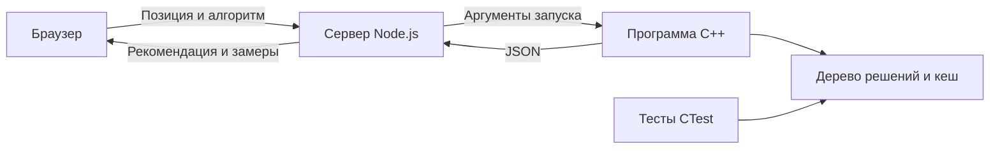

# Дизайн лабораторной работы № 2

## 1. Постановка задачи

### 1.1. Что делается в работе

Разрабатывается программа на C++17 для поиска хода ноликами в «Крестиках-ноликах» на поле 3 × 3. На вход подаётся расстановка крестиков и ноликов, на выходе программа выдаёт строку и столбец рекомендуемого хода. Крестики ходят первыми. Победу даёт линия из трёх одинаковых знаков по горизонтали, вертикали или диагонали.

Программа сравнивает полный минимакс и минимакс с альфа-бета-отсечениями и кешированием. Веб-интерфейс позволяет играть за X, редактировать позиции, запускать поиск и выгружать замеры в CSV.

| Пункт методички | Реализация | Баллы |
| --- | --- | ---: |
| И-13 | Крестики-нолики | 25 |
| И-13.2 | Графический интерфейс | 20 |
| М-5 | Хеш-таблица для ассоциативного доступа по ключу позиции | 12 |
| М-5.1 | Разрешение коллизий цепочками | 7 |
| | **Расчётный рейтинг** | **64** |

### 1.2. Для чего может быть нужна программа

Программа показывает, как отсечения и повторное использование результатов меняют объём поиска на одной и той же позиции. Режим игры позволяет проверить решения компьютера, а редактор — проверить конкретную тактическую ситуацию без воспроизведения всей партии.

## 2. Сущности прикладной задачи

### 2.1. Сущности с описанием

| Сущность | Состав и назначение |
| --- | --- |
| Позиция | Девять клеток в порядке строк. Клетка содержит X, O или точку. |
| Ход | Координаты пустой клетки и знак очередного игрока. |
| Результат поиска | Лучший ход O, оценка позиции и счётчики поиска. |
| Замер | Алгоритм, исходная позиция, результат, число запусков и среднее время. |

### 2.2. Связи между сущностями

Ход переводит одну позицию в другую. Поиск оценивает дочерние позиции и возвращает один рекомендуемый ход для исходной позиции. Сравнение создаёт по одному замеру на алгоритм для одинаковых входных данных.

## 3. Архитектура

### 3.1. Высокоуровневые компоненты

| Компонент | Назначение |
| --- | --- |
| `web/` | Отрисовка поля, редактирование позиции, показ хода и результатов, экспорт CSV. |
| `server.js` | Локальный HTTP-сервер для файлов интерфейса и вызова программы C++. |
| `src/main.cpp` | Приём параметров, замеры и вывод результата в JSON. |
| `src/game.cpp` | Проверка позиции и победы, поиск по дереву решений, хеш-таблица. |
| `tests/game_tests.cpp` | Проверка правил, допустимости и совпадения результатов алгоритмов. |

### 3.2. Связи между компонентами



### 3.3. Структуры данных, алгоритмы и принятые решения

Поле хранится в массиве из девяти символов. Победа проверяется по восьми линиям. Вход поиска должен содержать на один X больше, чем O, поскольку программа рекомендует ход O. Завершённая партия отклоняется.

Минимакс перебирает свободные клетки, временно ставит знак и рекурсивно оценивает полученную позицию. O максимизирует оценку, X минимизирует её. Победа O оценивается как 1 плюс число пустых клеток, победа X — противоположным числом, ничья — нулём. Это даёт предпочтение быстрой победе и позволяет отложить неизбежное поражение. При равенстве оценок выбирается первый ход в порядке «центр → углы → стороны».

Альфа-бета-поиск прекращает обход ветки, когда её оценка уже не влияет на выбор предка. Хеш-таблица хранит ранее вычисленные результаты внутри одного запуска поиска. Ключ состоит из троичного кода поля и признака очереди хода. Номер корзины — остаток от деления ключа на 257. Коллизии разрешаются цепочками в корзинах, где сравниваются полные ключи. Запись хранит точную оценку либо её верхнюю или нижнюю границу, пригодную для сужения окна поиска.

Для дерева с глубиной d и максимальным ветвлением b полный поиск в общем случае требует O(bᵈ) времени и O(d) памяти стека. Отсечения и кеш сокращают количество посещённых узлов в зависимости от позиции и порядка обхода. Кеш требует дополнительной памяти, пропорциональной числу сохранённых позиций.

## 4. Функциональные требования

| Действие | Ожидаемый результат и особые случаи | Обоснование |
| --- | --- | --- |
| Играть за X | Компьютер отвечает O. Победная линия подсвечивается. При победе или ничьей партия завершается. | Позволяет проверить решение в ходе игры. |
| Редактировать позицию | Можно менять знак кликом, ввести девять знаков по строкам или взять готовый пример. | Позволяет воспроизводить тактические ситуации. |
| Найти ход O | Выбранный алгоритм показывает координаты и выделяет пустую клетку. Недопустимый ввод или завершённая партия дают сообщение об ошибке. | Позволяет проверить рекомендацию вручную. |
| Сравнить | Оба алгоритма запускаются по 100 раз на одном входе. Программа выводит среднее время, число посещений узлов, отсечений и попаданий в кеш. | Позволяет сравнить результат и объём работы. |
| Выгрузить CSV | Файл содержит позицию, координаты, оценку, счётчики, число запусков и среднее время в микросекундах. | Данные можно анализировать в таблице. |
| Выполнить тесты | CTest проверяет правила, некорректный ввод, победу, защиту, ничью и совпадение алгоритмов на всех незавершённых позициях для хода O. | Проверяет корректность оптимизации на всём наборе допустимых входов. |

В измерение входит вызов алгоритма, включая создание его временных данных. Запуск процесса, HTTP и отрисовка не учитываются. Каждый запуск альфа-бета-поиска начинает с пустого кеша. Счётчики соответствуют одному запуску. В данном сравнении разные позиции играют роль разных исходных последовательностей в общей формулировке работы.

## Сборка и запуск

Нужны компилятор C++17, CMake и Node.js. Пакеты npm устанавливать не требуется.

```sh
cmake -S . -B build -DCMAKE_BUILD_TYPE=Release
cmake --build build --config Release
ctest --test-dir build -C Release --output-on-failure
node server.js
```

Открыть [http://127.0.0.1:3000](http://127.0.0.1:3000). Если порт занят, можно задать переменную окружения `PORT`.

Для MinGW при отсутствии генератора CMake можно собрать программу и тесты напрямую в PowerShell.

```powershell
New-Item -ItemType Directory -Force build
g++ -std=c++17 -O2 -Isrc src/game.cpp src/main.cpp -o build/solver.exe
g++ -std=c++17 -O2 -Isrc src/game.cpp tests/game_tests.cpp -o build/game_tests.exe
.\build\game_tests.exe
node server.js
```

Ручная проверка: открыть «Анализ позиции», нажать «Загрузить пример», затем «Сравнить». Для `XX..O....` оба алгоритма должны предложить клетку (1, 3): она блокирует победу X в первой строке.
